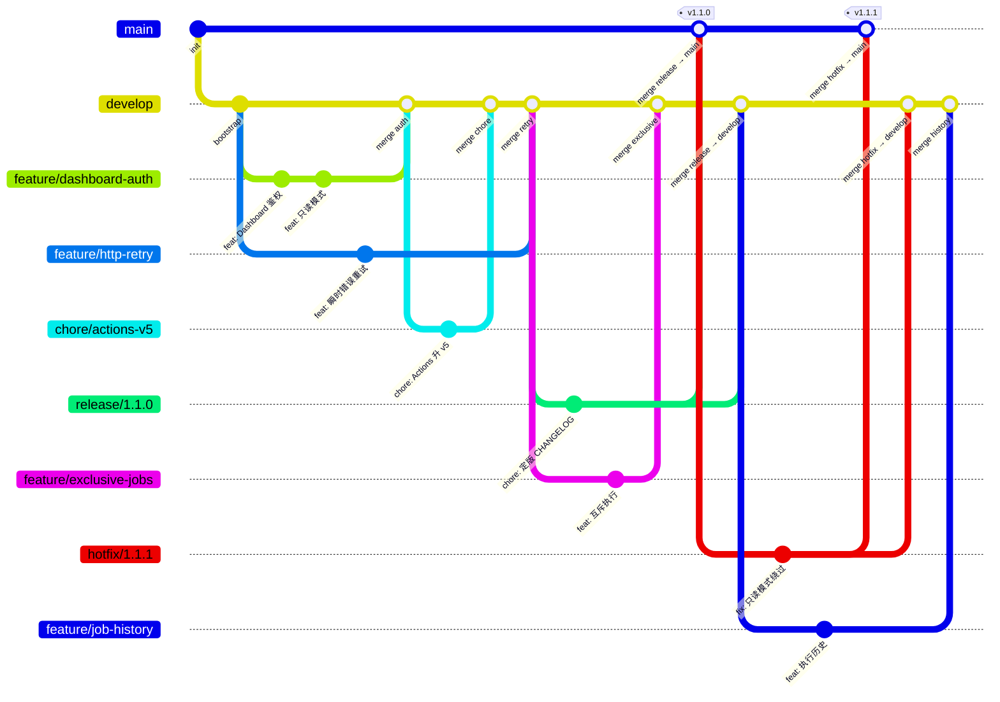

# 分支管理速览

> 本文是速查版：怎么用。完整规范、命令细节与设计理由见 [CONTRIBUTING.md](../CONTRIBUTING.md)。

## 分支模型（Git Flow）

| 分支 | 从哪开 | 用途 | 归宿 |
|---|---|---|---|
| `main` | — | **生产就绪**，任何 commit 可发布，每次合入打 tag | 永久 |
| `develop` | 初始化自 `main` | **集成主干**，跑全量 CI | 永久 |
| `feature/*` `fix/*` `chore/*` `refactor/*` `test/*` `docs/*` | `develop` | 单一职责的短命分支 | 合并即删 |
| `release/x.y.z` | `develop` | **发版冻结**：只修 bug + CHANGELOG 定版 | 双合后删除 |
| `hotfix/x.y.z` | **`main`** | **线上救火** | 双合后删除 |

命名：辅助分支用 `<type>/<短横线描述>`（全小写）；`release` / `hotfix` 用语义化版本号、不带 `v`——`v` 只出现在 tag 上。

## 全景图



图上可以看出多任务并行的三条规则：

- **`develop` 是集散地**：任意多个 `feature/*`、`fix/*`、`chore/*` 同时开出、各自独立合入，互不等待；
- **冻结只冻结 `release` 分支**：冻结期 `develop` 上照常并行开发（图中 `feature/exclusive-jobs`），它不属于本版本，也不会进 `release`；
- **救火与日常并行**：`hotfix` 基于 `main` 进行时，`develop` 上的开发（图中 `feature/job-history`）不受影响，靠双合把修复带回集成主干。

## 怎么用

### 1. 开发一个功能

```bash
git switch develop && git pull --ff-only
git switch -c feature/<短横线描述>
# …开发；提交信息遵循 Conventional Commits（feat/fix/chore…）
# PR → develop，合并方式 Merge commit，CI 绿后合并，分支自动删除
```

合入前顺手在 [CHANGELOG.md](../CHANGELOG.md) 的「未发布」段写一条条目。

### 2. 发布一个版本

```bash
# 1) develop CI 全绿后，切出 release 分支进入冻结
git switch develop && git pull --ff-only
git switch -c release/1.1.0 && git push -u origin release/1.1.0
#    冻结期只做两件事：修 bug；把 CHANGELOG「未发布」改成 1.1.0 并补「升级到本版本要做什么」

# 2) PR release/1.1.0 → main（Merge commit）

# 3) 打 tag 前核对，然后打 annotated tag
git switch main && git pull --ff-only
git rev-parse HEAD            # 必须等于下一行输出，否则停下排查
git rev-parse origin/main
git tag -a v1.1.0 -m "v1.1.0: <一句话说明>" && git push origin v1.1.0

# 4) PR release/1.1.0 → develop（把定版与修复带回集成主干）
# 5) 删除 release 分支
#    tag 推送后 CI 自动构建 Api/Worker 的 win-x64 / linux-x64 单文件包，
#    创建 GitHub Release 并挂载产物（dotnet.yml 的 publish job），无需手工操作；
#    打开自动生成的 Release 补「升级到本版本要做什么」即可
```

### 3. 线上救火（hotfix）

```bash
git switch main && git pull --ff-only        # 必须基于 main，修的才是线上那份
git switch -c hotfix/1.1.1
# 修复；PR → main（Merge commit），核对后打 v1.1.1（同发布第 3 步）
# 双合：PR hotfix/1.1.1 → develop；若此刻存在 release 分支，也要把它合进 release
```

## 平台保护（Rulesets）

| 目标 | 规则 |
|---|---|
| `main` | 禁删除、禁 force push、仅限 PR 合入；必需检查：编译与测试 |
| `develop` | 同上 |
| `v*` tag | 禁删除、禁改写（tag 触发 CD 发布产物，被改写等于发布通道被劫持） |

## 红线

- 所有合并一律 **Merge commit，不用 squash**
- `v*` tag 不可删、不可移动（ruleset 强制）
- `release` 冻结期不合新功能
- `hotfix` 必须双合 `main` + `develop`，否则下个 release 会把 bug 带回线上
- 发版后不开 `main → develop` 回灌 PR——「main 领先 develop」是 Git Flow 的正常形态
